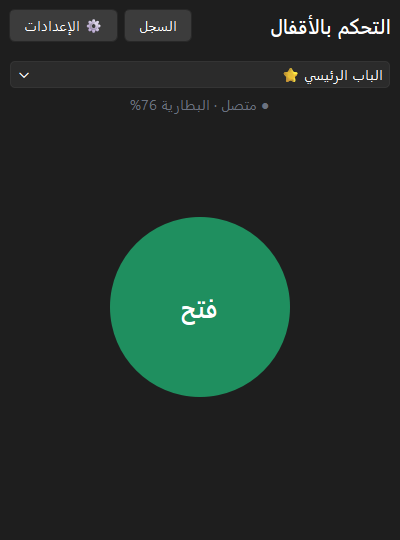
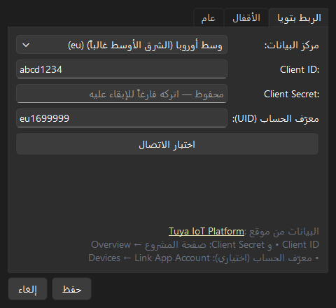
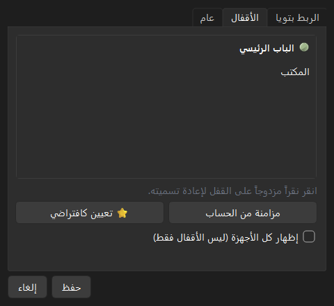
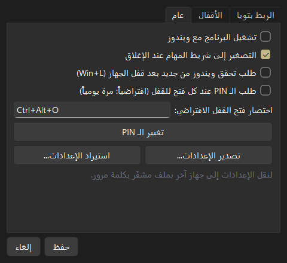
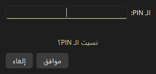

<div dir="rtl">

# Tuya Lock for Windows

برنامج ويندوز لفتح أقفال **تويا (Tuya / Smart Life)** الذكية من الكمبيوتر بضغطة زر، عبر **Tuya Cloud API**.

*A Windows desktop app (Python + PySide6) that unlocks Tuya smart locks through the Tuya Cloud OpenAPI, protected by Windows Hello and a PIN.*

<p align="center">
  
</p>

## المزايا

- **زر فتح كبير** يفتح القفل الافتراضي مباشرة.
- **عدة أقفال** مع قفل افتراضي ⭐، واختيار أي قفل آخر من القائمة.
- **حالة القفل**: متصل أو غير متصل، ونسبة البطارية أو حالتها.
- **مزامنة الأقفال** تلقائياً من حسابات Smart Life المرتبطة بمشروع تويا.
- **أيقونة في شريط المهام**: نقرة مزدوجة تفتح القفل الافتراضي، وقائمة لفتح أي قفل.
- **اختصار عام** (افتراضياً `Ctrl+Alt+O`) يفتح القفل حتى والبرنامج مصغّر.
- **التشغيل مع ويندوز** مصغّراً في شريط المهام.
- **سجل العمليات**: وقت كل عملية فتح ونتيجتها.
- **رسائل أخطاء عربية واضحة**: القفل غير متصل، انتهاء اشتراك تويا، ساعة الجهاز غير مضبوطة...
- **تصدير الإعدادات واستيرادها** بملف مشفّر بكلمة مرور، للنقل إلى جهاز آخر.
- **واجهة عربية** من اليمين لليسار، وتتبع الوضع الداكن أو الفاتح في ويندوز.

## الحماية

| الطبقة | متى تُطلب |
|---|---|
| **Windows Hello** (بصمة، وجه، أو PIN ويندوز). إن لم يكن مُعدّاً فكلمة مرور حساب ويندوز | مرة واحدة يومياً عند أول فتح |
| **PIN البرنامج** (4–8 أرقام) | مع تحقق ويندوز مرة يومياً، أو عند كل فتح للقفل إن فعّلت الخيار |
| **PIN عند فتح الإعدادات** | دائماً، لأن الإعدادات تحتوي Client Secret |

- 3 محاولات PIN خاطئة ← إيقاف مؤقت لمدة دقيقة. 5 محاولات ← يُلغى تحقق اليوم ويلزم Windows Hello من جديد.
- «نسيت الـ PIN؟» يعيد تعيينه بعد تحقق ويندوز.
- خيار لإعادة طلب التحقق بعد قفل الجهاز (`Win+L`).
- الـ PIN يُحفظ كبصمة مشفّرة (scrypt مع salt)، ولا يُحفظ الرقم نفسه أبداً.

## أين تُحفظ البيانات

| البيانات | المكان |
|---|---|
| الإعدادات، الأقفال، القفل الافتراضي، السجل | `%APPDATA%\LockControl\` (ملفات JSON تُكتب كتابة ذرّية مع نسخة احتياطية `.bak`) |
| Client Secret، توكن تويا، بصمة الـ PIN، حالة التحقق اليومي | **Windows Credential Manager** (الخدمة `LockControl`)، محمية بحساب ويندوز |

لا يحتوي هذا المستودع أي مفاتيح أو بيانات حساب.

## المتطلبات

- Windows 10 أو 11.
- حساب على [Tuya IoT Platform](https://platform.tuya.com) (الخطة المجانية تكفي).
- قفل تويا يدعم **الفتح عن بُعد**، مربوط بتطبيق Smart Life أو Tuya Smart.
- للتطوير: Python 3.12 أو أحدث.

## إعداد منصة تويا (مرة واحدة)

1. أنشئ مشروع **Cloud** على [Tuya IoT Platform](https://platform.tuya.com/cloud)، واختر **مركز البيانات نفسه** الذي يستخدمه حساب التطبيق. للشرق الأوسط غالباً *Central Europe*.
2. من **Cloud Services** فعّل خدمتي **IoT Core** و **Smart Lock Open Service**.
3. اربط حساب التطبيق: **Devices ← Link App Account**، وامسح رمز QR من تطبيق Smart Life.
4. فعّل **الفتح عن بُعد** للقفل من إعداداته في تطبيق Smart Life.
5. انسخ **Client ID** و **Client Secret** من صفحة المشروع (**Overview**).

> **تجديد الخطة المجانية:** اشتراك IoT Core التجريبي له مدة محددة. تجد تاريخ انتهائه في **Cloud ← Cloud Services ← My Services**، وتجدده من زر **Extend Trial Period**. إذا انتهى، يعرض البرنامج رسالة توضح ذلك.

## التثبيت والاستخدام

1. ثبّت البرنامج من ملف `LockControl-Setup-x.y.z.exe` (يُبنى كما في قسم «البناء»)، أو شغّله من الكود.
2. عند أول تشغيل: تحقق بـ Windows Hello، ثم اختر PIN للبرنامج.
3. **الإعدادات ← الربط بتويا**: اختر مركز البيانات وأدخل Client ID و Client Secret، ثم اضغط **اختبار الاتصال**.
4. **الإعدادات ← الأقفال**: اضغط **مزامنة من الحساب**، واختر القفل الافتراضي ⭐، ثم **حفظ**.
5. اضغط **فتح** 🔓

<p align="center">
  
  
</p>
<p align="center">
  
  
</p>

## التشغيل من الكود

</div>

```bash
python -m venv .venv
.venv/Scripts/python -m pip install -e ".[dev]"
.venv/Scripts/python -m lockcontrol
```

<div dir="rtl">

أداة سطر أوامر لاختبار الاتصال دون واجهة:

</div>

```bash
set TUYA_CLIENT_ID=...
set TUYA_CLIENT_SECRET=...
set TUYA_REGION=eu
.venv\Scripts\lockcontrol-cli token     # اختبار الاتصال
.venv\Scripts\lockcontrol-cli locks     # سرد الأقفال
.venv\Scripts\lockcontrol-cli regions   # مراكز البيانات
```

<div dir="rtl">

## الاختبارات

</div>

```bash
.venv/Scripts/python -m pytest -q
```

<div dir="rtl">

تغطي الاختبارات: توقيع الطلبات، وتجديد التوكن، والتخزين الذرّي، ومنطق الحماية والـ PIN، وخدمة الأقفال (بردود تويا محاكاة)، والواجهة (pytest-qt)، والاختصار العام وقفل الجلسة، والتصدير والاستيراد.

## البناء

</div>

```bash
powershell -ExecutionPolicy Bypass -File build.ps1
```

<div dir="rtl">

- البرنامج: `dist\LockControl\LockControl.exe` (PyInstaller، وضع onedir).
- المثبّت: `dist\LockControl-Setup-x.y.z.exe`، إذا كان [Inno Setup 6](https://jrsoftware.org/isinfo.php) مثبّتاً.
- للتشخيص: `LockControl.exe --self-check result.json` يتحقق من وجود Credential Manager و Windows Hello.

## بنية المشروع

</div>

```
src/lockcontrol/
├─ core/                    # منطق بدون واجهة
│  ├─ signing.py            # توقيع HMAC-SHA256 لطلبات Tuya OpenAPI
│  ├─ token_manager.py      # جلب التوكن وتجديده قبل انتهائه
│  ├─ tuya_client.py        # العميل: المناطق، الطلبات، إعادة المحاولة عند انتهاء التوكن
│  ├─ lock_service.py       # سرد الأقفال، الحالة، الفتح عن بُعد (أسلوبان مع تبديل تلقائي)
│  ├─ storage.py            # JSON ذرّي + نسخة احتياطية + Credential Manager
│  ├─ security.py           # التحقق اليومي، الـ PIN، حد المحاولات
│  ├─ windows_auth.py       # Windows Hello (WinRT) وبديل كلمة مرور ويندوز
│  ├─ autostart.py          # التشغيل مع ويندوز (HKCU\...\Run)
│  └─ backup.py             # تصدير/استيراد مشفّر (scrypt + Fernet)
├─ ui/                      # واجهة PySide6
│  ├─ main_window.py        # زر الفتح والحالة
│  ├─ settings_dialog.py    # الربط، الأقفال، الإعدادات العامة
│  ├─ auth.py               # نوافذ التحقق والـ PIN
│  ├─ controller.py         # شريط المهام، الاختصار، تطبيق الإعدادات
│  ├─ win_events.py         # RegisterHotKey وإشعارات قفل الجلسة
│  └─ messages.py           # رسائل الأخطاء العربية
├─ app_context.py           # يجمع الخدمات المشتركة
├─ cli.py                   # أداة سطر الأوامر
└─ __main__.py              # نقطة التشغيل (--minimized, --self-check)
```

<div dir="rtl">

## واجهات تويا المستخدمة

| الغرض | الواجهة |
|---|---|
| التوكن | `GET /v1.0/token`، `GET /v1.0/token/{refresh_token}` |
| سرد الأجهزة | `GET /v1.0/iot-01/associated-users/devices` (والبديل `GET /v1.0/users/{uid}/devices` عند إدخال UID) |
| الحالة | `GET /v1.0/devices/{device_id}` |
| الفتح | `POST /v1.0/devices/{id}/door-lock/password-ticket` ثم `POST /v1.0/smart-lock/devices/{id}/password-free/door-operate` (والبديل `.../door-lock/password-free/open-door`) |

كل عملية فتح تستهلك 2–3 طلبات API، وقراءة الحالة طلباً واحداً.

## حل المشكلات

| الرسالة | الحل |
|---|---|
| لا توجد صلاحية (1106) | تأكد من ربط حساب التطبيق (Link App Account) ومن مركز البيانات |
| المشروع غير مخوّل لهذه الخدمة | فعّل IoT Core و Smart Lock Open Service من Cloud Services |
| انتهى اشتراك خدمة IoT Core | جدّد من Cloud Services ← My Services ← Extend Trial Period |
| ساعة الكمبيوتر غير مضبوطة | فعّل «ضبط الوقت تلقائياً» في ويندوز |
| القفل غير متصل بالإنترنت | تحقق من اتصال القفل أو البوابة (Gateway) |
| هذا القفل لا يدعم الفتح عن بُعد | فعّل الفتح عن بُعد من تطبيق Smart Life، أو القفل لا يدعمه عبر الكلاود |

## الترخيص

[MIT](LICENSE). هذا مشروع مستقل غير تابع لشركة Tuya.

</div>
